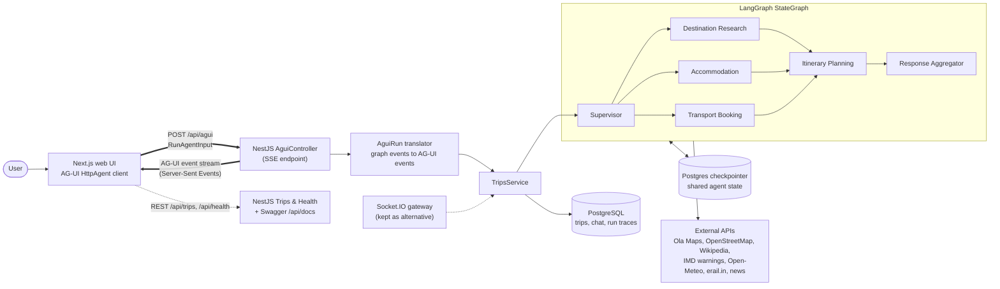
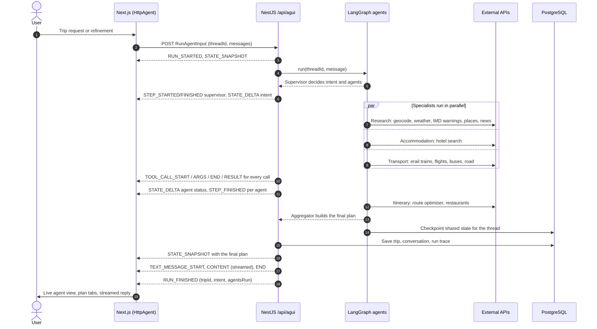
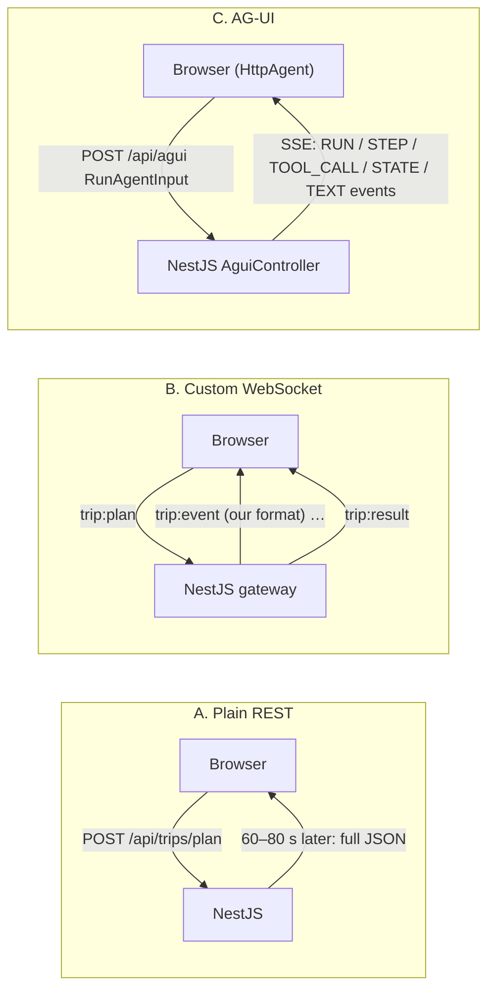
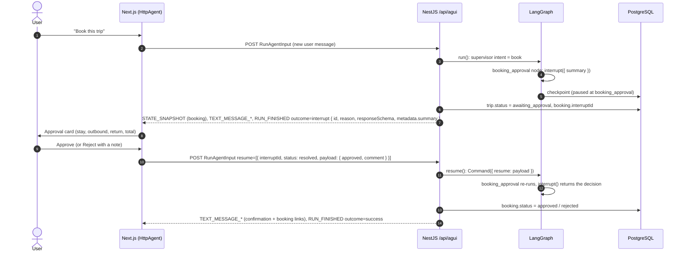
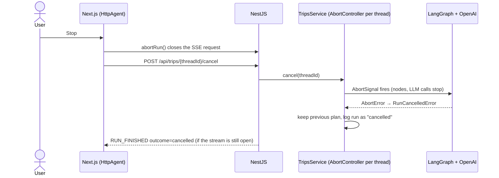

# AG-UI in Yatra AI

The original HLD connected the web UI to the backend with **REST + WebSocket**. We added **AG-UI**
(Agent–User Interaction protocol, <https://docs.ag-ui.com>), an open protocol for streaming agent activity to a UI.
This document shows where it sits, how one planning run flows through it, and its advantages and drawbacks.

- Endpoint: `POST /api/agui` (body: AG-UI `RunAgentInput`, response: `text/event-stream`)
- Backend: `backend/src/agui/agui.controller.ts` (SSE endpoint), `backend/src/agui/agui-run.ts` (graph events → AG-UI events)
- Frontend: `frontend/src/components/Planner.tsx` (`HttpAgent` from `@ag-ui/client`)

> Diagrams are written in Mermaid and render on GitHub/GitLab and in VS Code (Markdown preview with Mermaid support).

---

## 1. Updated architecture (HLD + AG-UI)

The HLD's components are unchanged. AG-UI replaces the custom WebSocket protocol between the UI and the API, and a
small translator turns LangGraph progress into AG-UI events.



Thick arrows: AG-UI request and stream · dotted: REST and the legacy Socket.IO channel · cylinders: PostgreSQL.

---

## 2. One planning run, event by event

Every step, tool call and state change reaches the browser as a typed AG-UI event, so the UI draws the live agent
diagram and tool feed without custom parsing.



A refinement such as *"make day 2 relaxed"* follows the same path with the same `threadId`; the supervisor marks the
other agents as skipped and only the itinerary planner and aggregator emit steps.

### Event mapping

| Graph activity | AG-UI events | Drives in the UI |
|---|---|---|
| Run lifecycle | `RUN_STARTED` … `RUN_FINISHED` (`result`: tripId, intent, agentsRun, errors, version) / `RUN_ERROR` | Busy state, error banner |
| Each agent (supervisor, 4 specialists, aggregator) | `STEP_STARTED` / `STEP_FINISHED` (`stepName` = agent id) | Agent diagram |
| Every external API call | `TOOL_CALL_START` / `ARGS` / `END` / `RESULT` (`metadata.agent`, `metadata.ok`, `metadata.durationMs`) | Live tool-call feed |
| Agent statuses, intent, reasoning, final plan | `STATE_SNAPSHOT` + `STATE_DELTA` (RFC 6902 JSON Patch) | Agent diagram, plan view |
| Aggregator reply | `TEXT_MESSAGE_START` / `CONTENT` (streamed) / `END` | Chat |

---

## 3. Advantages

| Advantage | What it means | In this app |
|---|---|---|
| **A standard contract instead of home-made events** | UI and backend agree on a published protocol, so any AG-UI client can drive the agents. | CopilotKit, a mobile app or a Python client could use `/api/agui` with no backend change. |
| **Event types that match what the UI shows** | Steps, tool calls with arguments and results, shared state and streamed text are built into the protocol. | The agent diagram is driven by `STEP_*` and state deltas; the tool feed by `TOOL_CALL_*`. |
| **Shared state with small updates** | One snapshot, then JSON Patch deltas; the client library applies them. | Agent statuses, intent and the final plan live in one state object the page renders directly. |
| **Plain HTTP and SSE** | Each run is a normal POST with a streamed response; works through proxies and load balancers without sticky sessions. | The backend can scale to several instances; Socket.IO would need sticky sessions or a Redis adapter. |
| **Built-in sequence checks** | The client rejects malformed streams (a tool result without a start, events after the run ends). | Our first real-model run passed 245 events through these checks, which doubled as an integration test. |
| **Room to grow** | The protocol covers interrupts for human approval, frontend tools, sub-agents and reasoning events. | An "approve this hotel before booking" step or per-specialist sub-agent events can be added without a new channel. |

## 4. Drawbacks

| Drawback | What it means | In this app / mitigation |
|---|---|---|
| **Not in the HLD, one more layer to own** | A translator maps LangGraph progress events to AG-UI events and must stay in step with both. | `agui-run.ts` (~140 lines) plus a new controller. |
| **A young protocol** | Version 1.0.x; packages move quickly and the spec may still change. | Pin `@ag-ui/*` versions and re-test on upgrades. |
| **Strict ordering can fail a whole run** | An unclosed step or tool call makes the client reject the stream. | Open steps are closed before `RUN_FINISHED` to guard against agent errors. |
| **Larger requests** | The client sends the full message history and shared state with every run. | Body limit raised to 10 MB; the UI trims old tool-call messages before each run. |
| **One-way, per run** | The server can only push while a run is open. | Cancellation is implemented: closing the request or calling the cancel endpoint stops the agents (see §7.2). |
| **Two real-time channels, harder debugging** | Socket.IO is kept deliberately as an alternative (same capabilities), and Swagger cannot display event streams. | Both channels share `TripsService`; use `curl -N` or an AG-UI client to inspect `/api/agui`. |

---

## 5. Before and after

| Concern | HLD: REST + WebSocket (Socket.IO) | Now: AG-UI over SSE |
|---|---|---|
| Event format | Custom `trip:event` payloads we defined | Standard typed events (`STEP_*`, `TOOL_CALL_*`, `STATE_*`, `TEXT_MESSAGE_*`) |
| Client code | Hand-written listeners and state reducers | `@ag-ui/client` applies state, messages and validation |
| Other clients | Must learn our event names | Any AG-UI client works as is |
| Scaling | Sticky sessions or a Redis adapter | Stateless HTTP per run |
| Direction | Two-way, connection stays open | Request then stream, one run at a time |
| Debugging | Socket.IO tools | `curl -N`, browser network tab |
| Maturity | Very mature | New (1.0.x) |

---

## 6. What AG-UI added, and what the app looks like without it

Most of what you see on screen does not come from AG-UI. The live agent diagram and tool-call feed already worked in
the first version of this app, which used a custom WebSocket channel (Socket.IO) with messages we invented. AG-UI
turned that custom setup into a standard one and added a few genuinely new capabilities.

### 6.1 The same app, three ways

| | **A. Plain REST** (no live channel) | **B. Custom WebSocket** (first version) | **C. AG-UI** (now) |
|---|---|---|---|
| How a run works | `POST /api/trips/plan`, then wait 60–80 s for one JSON answer | Socket.IO `trip:plan`, then our own `trip:event` messages, then `trip:result` | `POST /api/agui`, then a stream of standard AG-UI events |
| User sees while waiting | A spinner | Agent statuses and tool calls, live | Same, live |
| Reply text | Appears all at once | Appears all at once | **Streams word by word** |
| Plan delivery | In the final response | In the final message | **Shared state:** one snapshot, then small updates |
| Message checks | None | None (a bug just shows a wrong UI) | **Client rejects malformed streams** |
| Other clients (CopilotKit, mobile, Python) | Only by learning our JSON | Only by learning our message names | **Work as-is** |
| Running several backend servers | Easy | Needs sticky sessions or a Redis adapter | Easy (plain web requests) |
| Pausing for human approval | Build it yourself | Built by hand (`trip:resume`) | **Protocol interrupts** (`RUN_FINISHED` outcome `interrupt` → `resume`) |

Options A and B still exist in the project: try A in Swagger (`/api/docs` → `POST /api/trips/plan`); B is the Socket.IO
gateway (`trip:plan` event, see the README).

### 6.2 What it looks like without AG-UI

**A. REST only:** the user waits about a minute with no idea which agent is slow, whether the train search failed,
or whether anything is happening:

```
┌──────────────────────────────────────┐
│  ⏳ Planning your trip…              │
│                                      │
│  (60–80 s, then the whole plan       │
│   appears at once)                   │
└──────────────────────────────────────┘
```

**B. Custom WebSocket:** looks the same as today; the difference is underneath:

```
┌ Supervisor ✓ 3.0s ┐
├ Research ⟳ 8 tools ┤ Accommodation ✓ ┤ Transport ✓ ┤ Itinerary · idle ┤
└ Aggregator · idle ┘          Live tool calls: search_trains ✓ 4.8s …
```



### 6.3 The same moment on the wire

A transport agent starting a train search.

**Custom WebSocket (our invented format):**

```json
trip:event {"type":"tool","agent":"transport","callId":"call_7","tool":"search_trains",
            "phase":"start","input":{"fromCity":"Delhi","toCity":"Jaipur"}}
```

Only our frontend understands this. If someone renames `phase`, nothing catches it.

**AG-UI (standard format):**

```
data: {"type":"TOOL_CALL_START","toolCallId":"call_7","toolCallName":"search_trains","metadata":{"agent":"transport"}}
data: {"type":"TOOL_CALL_ARGS","toolCallId":"call_7","delta":"{\"fromCity\":\"Delhi\",\"toCity\":\"Jaipur\"}"}
data: {"type":"TOOL_CALL_END","toolCallId":"call_7"}
data: {"type":"TOOL_CALL_RESULT","toolCallId":"call_7","content":"…","metadata":{"ok":true,"durationMs":4815}}
```

Any AG-UI client knows these message types. Sending a result before its start, for example, makes the client stop
the run with a clear error.

### 6.4 Frontend code without AG-UI

With the custom WebSocket, the frontend needed its own handler that turned our messages into screen state:

```ts
socket.on('trip:event', (e) => {
  if (e.type === 'agent') setRuntime(r => ({ ...r, [e.agent]: { status: e.status, … } }));
  else if (e.type === 'supervisor') setSupervisor(…);
  else if (e.phase === 'start') setTools(t => [...t, …]);
  else setTools(t => /* find the matching running call by agent + tool and mark it done */);
});
socket.on('trip:result', (r) => { setPlan(r.trip.plan); setMessages(…); });
```

With AG-UI, the client library keeps the state up to date and the app just reads it:

```ts
await agent.runAgent({}, {
  onStateChanged: ({ state }) => { setRuntime(state.agents); setPlan(state.plan); },
  onToolCallStartEvent: ({ event }) => addTool(event),
  onTextMessageContentEvent: ({ textMessageBuffer }) => showTyping(textMessageBuffer),
});
```

### 6.5 The genuinely new capabilities

1. **Word-by-word reply:** before, the aggregator's message appeared at the end in one piece.
2. **Shared state:** the backend owns one state object (agent statuses, intent, plan) and sends small updates as it
   changes. Before, the plan only arrived in the final message.
3. **Message checks:** the client verifies message order. Our first real run doubled as a test, with 245 events checked.
4. **Works with other clients:** CopilotKit or any AG-UI client can drive the planner without changes. Before, every
   client had to learn our custom messages.
5. **Simpler scaling:** each run is an ordinary web request with a streamed response, so the backend can run on
   several servers without extra setup.
6. **Approval steps:** the protocol supports pausing a run to ask the user something. Used here for booking approval
   (§7.1).

### 6.6 When you could skip AG-UI

- **Planning runs take seconds and nobody needs to watch:** plain REST (option A) is simpler.
- **Only your own frontend will ever connect:** a custom WebSocket (option B) works fine. You maintain your own message
  format and lose the checks and the compatibility with other clients.
- **Other clients, or human-in-the-loop steps, are likely:** AG-UI is the better choice, which is why it is kept here.

---

## 7. Recommendations — implemented

| Recommendation | Status | How |
|---|---|---|
| Run cancellation | ✅ Done | Every run gets an `AbortController` (`TripsService`). The signal reaches every LangGraph node and every OpenAI call, so agents stop mid-step. Triggers: AG-UI client abort (`HttpAgent.abortRun()` closes the SSE request), `POST /api/trips/{id}/cancel` (any channel), Socket.IO `trip:cancel` or socket disconnect. An open AG-UI stream ends with `RUN_FINISHED` outcome `cancelled`. The previous plan is kept. |
| Keep Socket.IO as an alternative | ✅ Kept, same capabilities | `trip:plan`, `trip:cancel`, `trip:resume`; server replies `trip:result` (with `interrupt`), `trip:cancelled`, `trip:error`. |
| Pin `@ag-ui/*` and re-run the event-sequence test | ✅ Done | Exact versions `1.0.2` in both `package.json` files. `pnpm test:agui` (backend) replays planning, refinement, agent error, interrupt, cancellation and failure streams through the official `verifyEvents` from `@ag-ui/client`, plus a control case that must be rejected. |
| Human approval before booking (AG-UI interrupts) | ✅ Done | “Book this trip” → supervisor intent `book` → `booking_approval` node calls LangGraph `interrupt()` → `RUN_FINISHED` outcome `interrupt` with the booking summary → UI approval card → next run sends `resume` → LangGraph `Command({ resume })` continues → booking approved / rejected. |

### 7.1 Human-in-the-loop booking approval



| Situation | What the client sends | Result |
|---|---|---|
| Approve | `resume: [{ interruptId, status: 'resolved', payload: { approved: true } }]` | `booking.status = approved`, reply lists items with booking links |
| Reject | `resume: [{ interruptId, status: 'resolved', payload: { approved: false, comment } }]` | `booking.status = rejected`, plan unchanged |
| User ignores the card and types something else | `resume: [{ interruptId, status: 'cancelled' }]` **plus** the new user message (AG-UI clients must answer every open interrupt) | New message is planned normally; `booking.status = dismissed` |
| Reload the page while waiting | UI restores the pending approval from `trip.booking.interruptId` | Same card, same resume flow |
| REST / Socket.IO | `POST /api/trips/{id}/approval {approved, comment}` · `trip:resume {threadId, approved, comment}` | Same graph resume |

No live booking or payment API exists for these providers, so approval produces a confirmed booking checklist with the
booking links; nothing is charged or reserved automatically.

### 7.2 Cancellation



Other channels: Socket.IO `trip:cancel {threadId}` (also automatic on socket disconnect) → `trip:cancelled`;
synchronous REST `POST /api/trips/plan` returns `{ threadId, cancelled: true }`.

## 8. Try it

```bash
curl -N -X POST http://localhost:4100/api/agui \
  -H 'Content-Type: application/json' -H 'Accept: text/event-stream' \
  -d '{"threadId":"demo-thread-0001","runId":"run-1","state":{},"tools":[],"context":[],
       "messages":[{"id":"m1","role":"user","content":"Weekend in Rishikesh from Delhi by train for 3 friends, budget ₹15,000."}]}'
```

```ts
import { HttpAgent } from '@ag-ui/client';

const agent = new HttpAgent({ url: 'http://localhost:4100/api/agui' });
agent.addMessage({ id: crypto.randomUUID(), role: 'user', content: 'Plan 3 nights in Jaipur from Delhi' });
await agent.runAgent({}, {
  onStepStartedEvent: ({ event }) => console.log('agent started:', event.stepName),
  onToolCallStartEvent: ({ event }) => console.log('tool:', event.toolCallName, event.metadata?.agent),
  onTextMessageContentEvent: ({ textMessageBuffer }) => console.log(textMessageBuffer),
});
console.log(agent.state.plan); // final travel plan from shared state
```
